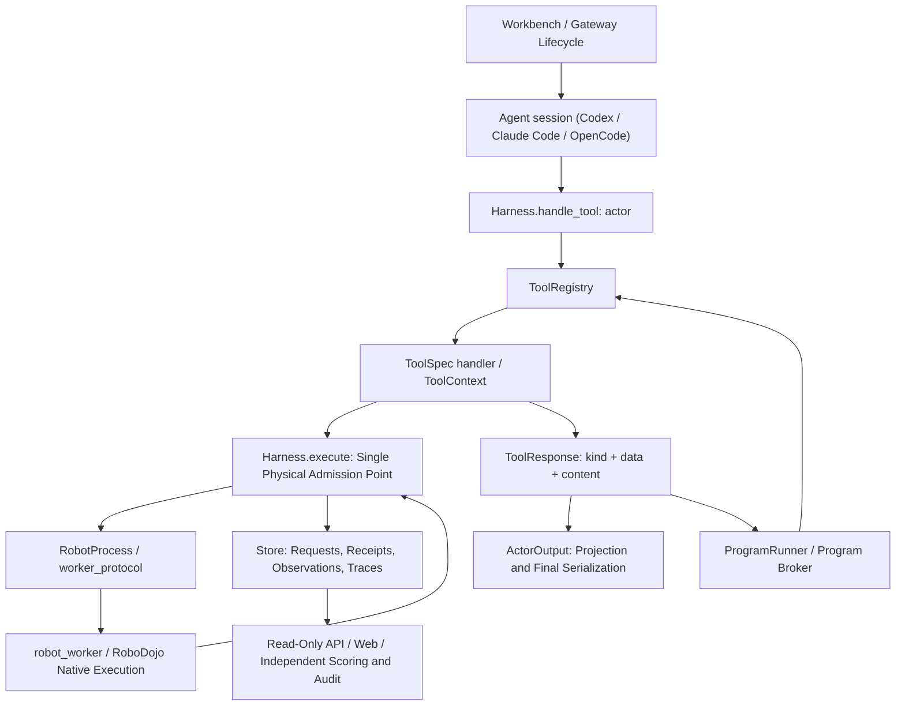

# Architecture and State Ownership

This document describes the current implementation layout to help contributors locate where changes belong. For conceptual background, see the [README](../../README.md) and the [Shared Protocol](../design/shared-protocol.md); before adding new functionality, read the [Development Conventions](../../AGENTS.md) and the [Extension Guide](extensions.md). Legacy actions, templates, skills, and `scene_*` tools that were restricted to the `trusted_legacy` role were removed in the 2026-10 refactoring.

## End-to-End Call Flow



`Workbench` assembles services and owns the startup/shutdown lifecycle, `Harness` manages intra-run action identity, state, and admission, and the worker executes physical motion. The agent session itself is one of three interchangeable hosted backends behind the shared `AgentSession` contract (`cortex/agents/base.py`), or the `external` backend where NI-RUA launches no agent and the user's own agent connects over MCP; `cortex/agents/factory.py` selects the one named by `agent.backend` (`codex`, `claude_code`, `opencode`, `external`) without importing the other backends' SDKs. Neither cross-process timeouts nor process exits alone prove that an action did not execute. Tools return typed facts, and only the presentation layer serializes external `{success, contentItems}` payloads. The program broker consumes raw typed data, while generated programs call `NiRuaClient.call` to read a `kind/data` copy that has passed through the same information boundary projection. Neither path infers execution quantities by parsing model-readable text, though `contentItems` is preserved for client compatibility.

## Module Map

`ni_rua/` is organized into six top-level packages layered in strict downward order (`core -> robot -> perception -> cortex -> runtime -> apps`): module-level and runtime imports in lower layers never pull upper layers; cross-layer integration uses narrow ports/protocols (`core/embodiment.py`, `robot/contracts.py`, `perception/ports.py`, `cortex/agents/plugin_contract.py`) injected at assembly time.

```text
ni_rua/
  core/        Shared leaf kernel: embodiment contracts, typed config/, information boundary, storage, model presentation
  robot/       Capability contracts, IPC, unified N-DoF kinematics, embodiments/{arx_x5,so101}, calibration/, motion/, backends/
  perception/  Visual comparison, overlays, optional external perception, RGB-D, scene storage, ObservationEnrichment ports
  cortex/      Unified agent sessions (agents/{codex,claude_code,opencode,external}), relay/{server,guard,payload,continuity}, context/, supervision/
  runtime/     Harness (EpisodeStateLedger, ObservationPipeline, DecisionContextBridge), robot_action, ToolRegistry & ToolContext, programs/, policy/
  apps/        Executable applications: capability-mounted gateway/ (supervisor, read_router, extensions/), library/, evaluation/, replay/, reference/
```

Paths in the table below are relative to `ni_rua/`, while `configs/`, `web/`, `third_party/`, `tests/`, and `scripts/` are relative to the repository root.

| Location | Responsibilities and Modification Scope |
| --- | --- |
| `core/contracts.py`, `core/action_validation.py`, `core/embodiment.py` | Run/action identity, core contracts for requests/observations/receipts, pure data validation, and the leaf `EmbodimentProfile` v1/v2 data contract + SE(3) math. |
| `core/config/`, `configs/ni-rua.json` | Typed configuration sections (`sections.py`, `loader.py`, `thresholds.py`), defaults, and runtime overrides; see [Configuration](configuration.md) for machine paths and model authentication. |
| `core/observation_policy.py`, `core/presentation/` | Observation profiles and actor information boundary; named projection of typed results, ID aliasing, and metadata filtering. Owners such as `observation_output.py` and `history_output.py` define their respective summaries. |
| `core/tool_output.py`, `core/tool_errors.py` | `ToolResponse`/`ToolOutput` and actionable input diagnostics shared across tool owners. |
| `core/storage/` | SQLite events/state/references and artifact bytes, RGB encoding, and read-only paginated projections; sealed archive reading and compressed image reconstruction have explicit interfaces. |
| `robot/contracts.py`, `robot/ipc/`, `robot/embodiments/` | Formal capability protocols (`RobotBackend`, `EvaluatorBackend`, `VideoBackend`, `OperatorBackend`, `CalibratableBackend`), shared `WorkerProcess` / `serve_worker` IPC, and per-robot embodiment packages (`arx_x5/`, `so101/`). |
| `robot/model/`, `robot/calibration/` | Unified N-DoF kinematics (`kinematics.py`), `EndEffectorGeometry`, `CalibrationCorrection`, `embodiments.py` facade, and operator-gated calibration workflows (`calibration/workflow/`) + offline evidence (`calibration/evidence/`). |
| `robot/motion/` | Pure batch/queue/proxy contracts, N-DoF motion compilation, `BatchScheduler` / `BatchContinuation`, `contact_reanchor`, velocity/tolerance/gripper guards, and failure diagnostics; also runs inside the simulation worker (see [Robot Backend Boundaries](robot-backend-boundaries.md)). |
| `robot/backends/` | Environment construction (`factory.py`); `robodojo/` (host-side process owner, JSONL protocol, Isaac thread worker, native configuration/recording) and `so101/` (real follower arm backend, worker, deployment, motion video). See [Robot and Environment Integration](robot-environment-integration.md). |
| `perception/` | Image comparison and view selection (`ports.py` / `EpisodeStatePort` decoupling runtime); `overlays/` draws contact and trajectory references; `external/` provides optional external perception (object table, `scene3d`, VGGT height, in-hand perception, and pose planning); `depth/` provides numeric tools under explicit RGB-D profiles. |
| `perception/scene/` | Builds bounded scenes, versioned geometry, and snapshots from permitted observations; never reads hidden ground truth and does not promise full physical rollouts. |
| `cortex/agents/` | Backend-neutral `AgentSession` / `AgentBackend` contract (`base.py`, `backend.py`), explicit `plugin_contract.py` & `registry.py`, shared MCP server/turn/dispatch (`mcp_server.py`, `mcp_session.py`, `dispatch.py` with `EmittedOrder` concurrent call ordering), `AgentSandbox` / `isolation.py`, and per-backend packages (`codex/`, `claude_code/`, `opencode/`, `external/`). See [Agent Backends](agent-backends.md) and [Agent Plugin](agent-plugin.md). |
| `cortex/relay/`, `cortex/session/` | Modular loopback model relay (`relay/{server,guard,payload,continuity}.py` + `ModelRequestProxy.settle()`) with per-wire egress scrubbing (`session/wire/`), terminal, token accounting, auxiliary visual review, and the curated `/harness` source snapshot (`session/actor_source.py`). Compatibility shims live in `cortex/_compat.py`. |
| `cortex/context/`, `cortex/supervision/` | Startup instructions, official task rules and overrides, task plans, operational experience, and guidance; post-turn stall detection, recovery, and completion reminders. |
| `runtime/harness.py`, `runtime/episode_ledger.py`, `runtime/observation_pipeline.py`, `runtime/decision_bridge.py`, `runtime/supervision.py` | Intra-run action identity, idempotency, state/budget admission (`EpisodeStateLedger`), observation enrichment (`ObservationPipeline`), context reminders (`DecisionContextBridge`), and the single physical entry point `Harness.execute`; startup, turn, and stop waiting. |
| `runtime/actions/` | `robot_action` schema generated from the run profile (`robot_action_schema.build(profile)`), batch compilation/preview/cached execution and continuation (`unified_actions.py`), inspection and contact overlays, and post-action feedback; replaying historical receipts never mutates the active plan cursor. |
| `runtime/tools/` | Public tool declarations, handlers, and built-in assembly routed uniformly through `ToolContext`; `registry.py` governs inputs/outputs, roles, effects, and availability, `context.py` provides the narrow plugin port, and `plugins/` houses optional self-contained `ToolSpec` plugins. |
| `runtime/programs/` | Program lifecycle, configurable OS isolation, FD broker, review, cancellation, and action evidence; `ni_rua_client.py` is copied into the program workspace by filename. Consumes bound callbacks via frozen `ProgramServices` without holding the robot or registry directly. |
| `runtime/policy/` | Optional OpenPI policy bridge; `policy_workers/` run in their dedicated Python interpreter while physical execution remains owned by `Harness`. |
| `apps/gateway/` | Declarative `cli.py`, `RunSupervisor` (`supervisor.py` + `server.py`), core `GatewayRouter` (`routes.py`), shared `RunReadRouter` (`read_router.py`), `Workbench` composition (`workbench.py`), and capability-mounted `extensions/{operator_console,calibration,agent_settings,handoff}.py`. |
| `apps/evaluation/`, `apps/library/` | Queue/retry/completion hooks (checkout launch layout in `evaluation/checkout_layout.py`), source binding, reporting/auditing; experiment catalog, comparisons, independent scoring policy, and the persistent experiment library service sharing `RunReadRouter` + manifest-driven asset serving. |
| `apps/replay/`, `apps/reference/` | Resimulates/records from archived actions or exports data-only trajectory ZIP bundles (true replay must maintain `model_calls=0`); RoboProbe reference baseline. |
| `web/` | Shared frontend utilities (`web/shared/{api-client,lease-client,dom}.js`), real-robot console (`/console`), calibration wizard (`/calibration`), records workspace (`/index.html`), experiment library, `build.mjs` (emitting `manifest.json`), and `check.mjs` auto-discovered syntax + unit test runner. Built assets are packaged into the wheel. |
| `third_party/` | Provenance records and reference assets; preserve license and version metadata and never silently swap in host directories. |
| `agent-plugin/` | The npm package `@nerveint/ni-rua-plugin`: per-host manifests with HTTP MCP entries to the external backend's endpoint, the `ni-rua-robot` and `ni-rua-experiments` skills, and the `ni-rua-plugin` installer; no Python. `.codex-mcp.json` is generated from the tool registry by `scripts/gen_agent_plugin_codex_mcp.py`. See [Agent Plugin](agent-plugin.md). |
| `tests/`, `scripts/run_tests.py`, `scripts/run_tests_per_module.py`, `scripts/build_package.py`, `scripts/check_package.py` | CPU contract and fault regressions, the parallel full-suite runner (and per-module compatibility wrapper), full package build, and out-of-checkout verification. |

Different Python interpreters load different subsets of the codebase:
- The gateway, evaluation queue, and experiment library run in the `ni-rua` environment.
- `robot/backends/robodojo/robot_worker.py` and `apps/replay/hd_replay.py --worker` run inside the RoboDojo/Isaac Python interpreter. The worker's module-level dependencies are restricted to `core/` and `robot/`, so any new worker dependency must be importable in that interpreter.
- `runtime/policy/policy_workers/` are launched by file path inside the OpenPI environment.
- Program workspaces only receive `ni_rua_client.py` and, when enabled, `scene3d_helpers.py`.

Command entry points include `python -m ni_rua.apps.gateway` (console script `ni-rua`), `python -m ni_rua.apps.library`, `python -m ni_rua.apps.evaluation.queue` (`ni-rua-queue`), and `python -m ni_rua.apps.replay.hd_replay`. Checkout launch layout helpers live in `apps/evaluation/checkout_layout.py`.

## Embodiment Profile

One resolved, frozen `EmbodimentProfile` per run (`robot/model/embodiments.py`) is the single source for robot facts: arm ids, frame and TCP, gripper zero point and full opening, speed and tolerance ranges, clock, cameras, and which `robot_action` fields the robot supports. Shared validators, the `robot_action` schema and tool definitions, actor instructions, perception hints, trajectory evidence, the home check and presentation read `harness.embodiment`; shared code defines no arm set, gripper number or camera role of its own, and the only remaining "default robot" is the ARX X5 fallback for backends without the hook. The model-visible text is rendered from the profile by the same builders for every robot, and fields a robot cannot honour are absent from its schema. Call path: backend `embodiment_profile()` -> `Harness.embodiment` -> `create_registry` / `public_definitions(profile=...)` -> `robot_action_schema.build(profile)` -> `unified_actions` validation, plus `actor_instructions.instructions(..., profile=)`. Adding a robot, the configuration surface, the X5 golden fixtures and the approved X5-visible changes are in [Embodiment Profile](embodiment-profile.md).

## State and Fault Rules

| State / Data | Authoritative Owner | Usage Rules |
| --- | --- | --- |
| Embodiment profile | Backend hook, resolved once by `Harness` and archived as a configuration record | Read-only for every consumer; offline readers restore the archived record (`profile_from_record`), never the live backend; the record is observer data and never enters model context. |
| Current run identity, observation, action budget | `Harness` | Tools receive snapshots; any action that may advance physical state invalidates prior observations if its terminal frame is missing. A fresh `observe` only replenishes observations and cannot clear `unknown`/`stop` gates. |
| Plan revision / cursor | Batch plan owner | Advances at execution checkpoints; historical replay returns historical facts without advancing or rewinding the cursor. |
| Execution status, control / native steps | Worker receipt, persisted by `Harness` | Preserves the distinction between `completed`, `partial`, `stopped`, and `unknown`; presentation failures never overwrite execution facts. |
| Program status and review | `ProgramRunner` | `succeeded` means the program process exited with 0 and was neither cancelled nor marked `unknown`; task success, action completion, and output delivery are evaluated independently. |
| Geometry validity | Evidence actually referenced by the scene entity | The same entity validates time, clock/step domain, and freshness against the exact subset of evidence it references; newer timestamps from unrelated observations cannot revalidate stale geometry. |
| Task success / score | Independent native evaluator + scoring policy | Never reads self-reported success from the actor; corrupted archives or missing evidence remain `null`, reporting against a fixed case denominator alongside valid counts. |
| Blob integrity | Store reference + byte verification + audit profile | A database row existing does not mean the file exists; reconstructed images never impersonate original image bytes, and passing integrity checks does not imply task success. |

If optional presentation rendering fails after an action has already executed, the system returns the original `ToolResponse(kind="action", data=...)` with post-handler delivery diagnostics and an explicit notice prohibiting automatic replay. If terminal state sampling fails, known step counts and existing trajectory points are preserved while explicitly marking the missing terminal boundary sample—commanded trajectories must never be substituted for measured trajectories.

## Read Access and Information Boundary

The actor reads permitted RGB images, proprioceptive state, and public calibration; RGB-D requires an explicit observation profile. Final actor presentation recursively strips provenance fields such as hashes, source URLs, file paths, repositories, and commit IDs while preserving action diagnostics and domain measurements. Program presentation and historical cache replay apply the same filtering and reversible short references, whereas raw typed data and observer artifacts retain full facts. Full-result queries let domain owners decide content without maintaining a separate receipt allowlist at the final projection stage. Codex session prompts, auxiliary model evidence, program logs, and text artifacts all pass through the shared presentation layer, and the Responses request egress filters readable text again for resumed history and compacted turns. Local and remote $\pi_{0.5}$ inference also scrubs hashes from task prompts. Media bytes, encrypted reasoning items, and native protocol IDs are transport payloads and must not be rewritten as plain text. For detailed rules and regression tests, see [Tool Plugins](tool-plugins.md).

When `features.sandbox_enabled=true`, the primary Codex app-server, native tools, and subagents run inside a bubblewrap namespace mounting only the private workspace, session directory, explicitly published read-only Harness source, and runtime dependencies. Web search and host extensions are disabled, and network access is restricted to the fixed model/account relays and the PyPI package proxy. Native local tool search over registered tools does not access external networks, and dispatch is still validated by the same `ToolRegistry`. Real authentication credentials remain in the host relay, while standalone programs and the evidence agent each maintain their own isolation boundaries. Setting `features.sandbox_enabled=false` (the default) disables both the primary/auxiliary Codex namespaces and `program_run` Landlock/seccomp isolation while retaining private session directories, relays, the broker, action review, and resource budgets; code can access host files and networks permitted to the launching user, and the information boundary is enforced at the application layer only. The sandbox mode is frozen for the lifetime of a run, and resuming across modes is rejected. See [Code Execution Sandbox](configuration.md#code-execution-sandbox) for details. The namespace is built by the backend-neutral `AgentSandbox` ([`agent_sandbox.py`](../../ni_rua/cortex/session/agent_sandbox.py)): private read-write state directories, read-only executables and paths (the published Harness snapshot at `/harness`, which Workbench writes to `<run>/private/actor-source` for every backend before the session starts), outbound loopback ports relayed to the host through run-owned Unix sockets at unchanged `127.0.0.1` port numbers, and inbound ports through which the host reaches a server inside the namespace over `<ipc>/inbound/<port>.sock` (for the OpenCode HTTP API). RoboDojo, simulator assets, observer data and the full checkout are never mounted. `CodexSandbox` ([`codex/sandbox.py`](../../ni_rua/cortex/agents/codex/sandbox.py)) adds `CODEX_HOME`, `CODEX_CA_CERTIFICATE` and the pinned `/tmp/codex-daemon-<uid>` socket directory; its command line is pinned by a golden ([`test_agent_sandbox.py`](../../tests/packaging/sandbox/test_agent_sandbox.py)). Claude Code runs in the same namespace when the session is built with `features.sandbox_enabled=true` ([`claude_code/options.py`](../../ni_rua/cortex/agents/claude_code/options.py) `build_launch(sandbox=SandboxPlan(...))`, wired by `ClaudeCodeSession._sandbox_plan`): the SDK still spawns the launcher on the host, and the launcher `exec`s `env -i bwrap ... <supervisor> <real CLI> "$@"` (stdio passes through, the SDK-injected `CLAUDE_CODE_ENTRYPOINT`, `CLAUDE_AGENT_SDK_VERSION` and `CLAUDE_CODE_SDK_READS_SESSION_STATE` are re-exported with `--setenv` when set). Inside: the real bundled CLI (read-only), `private/claude-config`, `private/tmp`, `private/run` and the actor directory (read-write at their host paths), the instructions file (read-only), `/harness`, the model relay and MCP endpoint at their unchanged loopback ports, and the PyPI proxy; `IS_SANDBOX=1` is still set only when the gateway runs as uid 0 (the namespace keeps the host uid). The isolation is recorded in `runtime/agent.isolation` and the manifest (`agent_backend.isolation`), and resuming across modes is rejected (`resume_isolation_changed`). OpenCode runs `opencode serve` in the same namespace (`OpenCodeSession._prepare_sandbox`): the pinned binary at `/opt/ni-rua-bin/opencode`, its private XDG data/cache/state directories (read-write), the config directories and instructions file (read-only), `/harness`, the relay and MCP endpoint as outbound ports, and its own HTTP port as an inbound port, so the host client talks to it only through `<ipc>/inbound/<port>.sock`. `factory.backend_requirements` accepts `features.sandbox_enabled=true` for every backend (conformance item 28 verifies the boundary on Linux for Codex, Claude Code and OpenCode); a host without bubblewrap fails at session start, before the native agent exists. See [Agent Backends](agent-backends.md#sandbox-featuressandbox_enabled-all-backends).

Sealed archives must always be opened via `open_read_store(root)`, which reads from a private copy when a WAL file is present; reading an active run uses the existing `live=True` protocol. Never open an active WAL database in immutable mode. Standalone replay initialization writes locks, Store records, and scene state, so it must point to a copy; use the read-only experiment library interfaces when inspecting original archives in place.

**Store lifetime.** A run's `Store` ([`store.py`](../../ni_rua/core/storage/store.py)) shares one SQLite connection between every thread of the gateway; each access and `close()` hold the same lock, so `close()` waits for an access in flight and never closes the connection under another thread (that crashed the process with SIGSEGV; [`test_store_close_race.py`](../../tests/core/storage/test_store_close_race.py)). Closed means closed: every later access, including `raw_codex` / `raw_agent` appends and `put_artifact` blobs, raises `StoreClosed` (a `sqlite3.ProgrammingError`) and leaves the finalised run directory unchanged. Before this rule a raw line that arrived after close was still appended to `codex-raw.jsonl` / `agent-raw.jsonl` while its Store row failed. Refusals are counted per method in `Store.refused_after_close` and the first one prints a gateway stderr line; because nothing can be written to a closed run, the owner records the risk beforehand: session close reports name the reader threads that outlived their bounded join (`threads_alive`) and a model listing still being read (`model_listing_pending`), see [Agent Backends](agent-backends.md). Code that uses `Store.db` directly must hold `Store.lock`; `SceneService` reads its own private Store without the lock, on its single event-loop thread only. None of this is model context.

## Extensions and Package Boundaries

New tools are injected into `Workbench`/`Harness` via an explicit `ToolSpec` list; there is no automatic plugin scanning or dynamic installation service. Built-in capabilities use the same registry, and program permissions, availability, and final tool catalogs are derived from that single declaration. When modifying a contract, verify input validation, typed results, actor presentation, program consumption, manifests, and backward compatibility with historical archives.

Running from source and running from a built wheel use the same Python package; the build script additionally bundles default configurations, built Web assets, and reference resources, and package checks execute outside the repository checkout. When adding modules or assets, verify the wheel manifest rather than relying on files that happen to exist in the working tree during local tests. Large modules can be split along existing ownership boundaries without introducing a new generic plugin framework.
